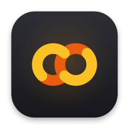
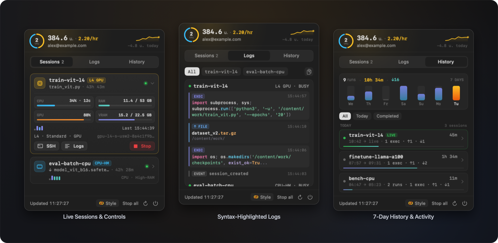
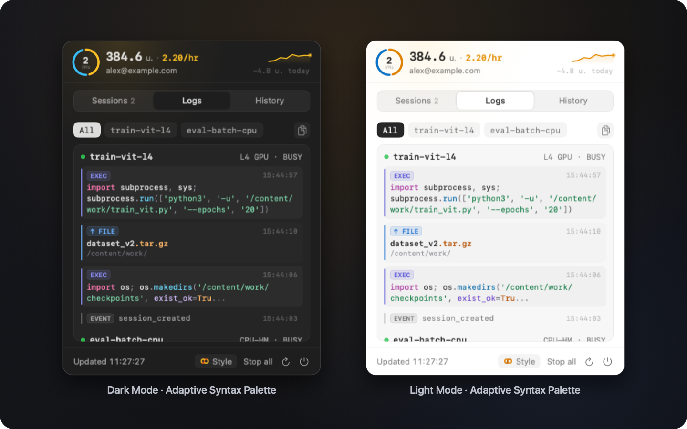
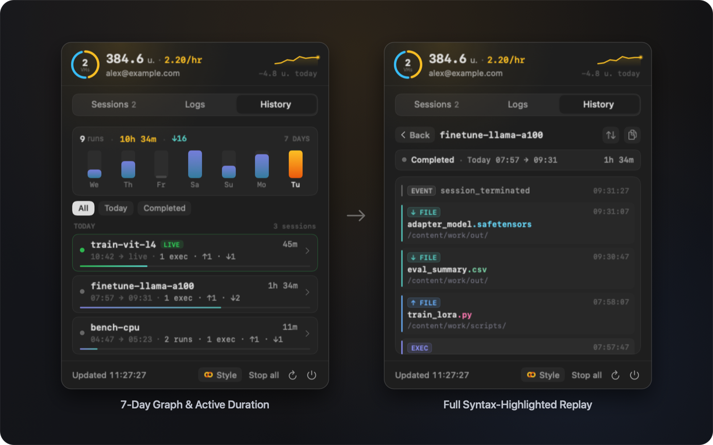
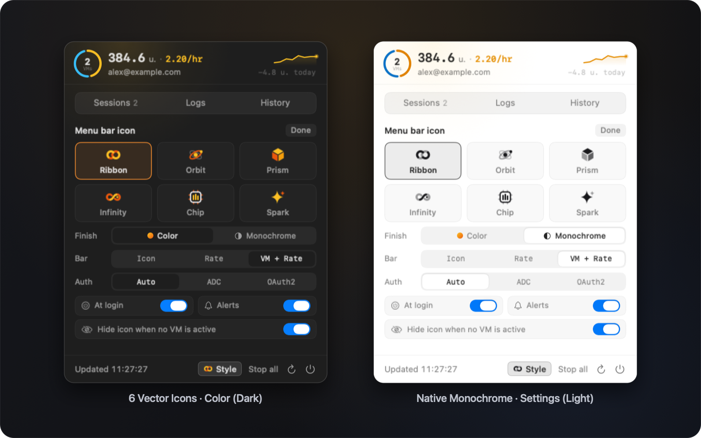

<div align="center">
  
  <h1>ColabMonitor</h1>
  <p><strong>A lightweight, native macOS menu bar monitor for Google Colab CLI sessions.</strong></p>
  <p>
    
    
    
    
  </p>
</div>

<p align="center">
  
</p>

Keep track of your remote Google Colab GPUs and High-RAM CPUs directly from the macOS menu bar — live compute-unit balance, burn rate, false-positive-free `IDLE` alerts, syntax-highlighted execution logs, and full session history. Built as a single zero-dependency Swift file that compiles in seconds without Xcode.

---

## Features

- **Visual Header & Telemetry** — Segmented active-VM ring (color-coded per GPU / CPU-HM / IDLE runtime), compute-unit balance & burn rate (`u./hr`), live burn-rate sparkline + daily spend (`−4.8 u. today`), ambient status glow, and external browser runtime count (`+N web`). Polls every 20s while active and sleeps to 90s when idle.
- **Live CPU, RAM, GPU & VRAM Meters** — On-demand hardware telemetry inside expanded session cards (`CPU % · cores`, `RAM GB`, and `GPU %` + `VRAM GB` via `nvidia-smi`), sampled over `colab ssh --` outside the Python kernel so it never blocks running jobs or pollutes `colab log` (and never fires when the popover is closed).
- **Rich Live Session Cards** — Hardware badges (`GPU` / `CPU-HM` / `CPU`), live status halos, elapsed uptime, 10-bar color-coded event activity strip (`EXEC` / `↑` / `↓`), one-click `SSH` copy, and safe two-step `Stop` / `Stop all` controls.
- **Smart `IDLE` Detection & Native Alerts** — Cross-checks local `colab exec / install / upload / download` processes so long-running scripts never trigger false `IDLE` warnings, with optional macOS alerts when a VM finishes or stays `IDLE` for 5+ minutes.
- **Syntax-Highlighted Logs** — Structured log cards with adaptive Dark/Light syntax coloring for Python/shell `EXEC` snippets and semantic file-extension highlighting for `↑ FILE` uploads and `↓ FILE` downloads.
- **7-Day Visual Compute Graph & Full Session History** — Interactive 7-day bar chart with live KPI totals (`runs`, compute duration, `↓` artifacts), click-any-day filtering, proportional duration bars per run, chronological/newest-first toggle, and full syntax-highlighted log replay directly from `colab log`.
- **6 Retina Vector Icons × Color / Monochrome + Auto-Hide** — Switch live between **Ribbon**, **Orbit**, **Prism**, **Infinity**, **Chip**, and **Spark** in Colab gold/amber or native macOS monochrome (`isTemplate`), plus bar density (`Icon` / `Rate` / `VM + Rate`), auth mode (`Auto` / `ADC` / `OAuth2`), **At login**, and **Hide icon when no VM is active** (automatically reappears as soon as a VM starts, or anytime you reopen ColabMonitor from Spotlight/Applications).

---

## Requirements

- **macOS 14 (Sonoma)** or later (Apple Silicon or Intel)
- **Swift Command Line Tools** (`xcode-select --install` — no full Xcode install needed)
- **[google-colab-cli](https://pypi.org/project/google-colab-cli/)** (`uv tool install google-colab-cli`), signed in via `ADC` or `OAuth2`

---

## Quick Install

```bash
git clone https://github.com/tofunori/colab-monitor.git
cd colab-monitor
./build.sh
open ~/Applications/ColabMonitor.app
```

> Pass `--system` to install to `/Applications/ColabMonitor.app` instead of `~/Applications/ColabMonitor.app`.
> Once running, open **Style** in the footer and toggle **At login** to start ColabMonitor automatically when you log in.

---

## Screenshots

### Adaptive Syntax Highlighting (Dark & Light)

<p align="center">
  
</p>

### Session History & Replay

<p align="center">
  
</p>

### 6 Vector Menu Bar Icons & Settings

<p align="center">
  
</p>

---

## How It Works

ColabMonitor only invokes the official `colab` CLI (`usage`, `sessions`, `status`, `log`, `whoami`, `stop`) as short-lived subprocesses and never reads OAuth tokens, cookies, or internal session credential files.

- **Binary lookup**: checks `$COLAB_BIN`, `~/.local/bin/colab`, `/opt/homebrew/bin/colab`, `/usr/local/bin/colab`, and your `$PATH`.
- **Auth modes**: `Auto` uses `--auth=adc` when `~/.config/gcloud/application_default_credentials.json` is present and falls back to the CLI default otherwise. You can pin `ADC` or `OAuth2` anytime in **Style**.
- **Launch at login**: writes a clean user agent at `~/Library/LaunchAgents/com.colabmonitor.app.plist` and deletes it when toggled off.

---

## Development & Self-Test

```bash
# Build release bundle + Retina AppIcon.icns
./build.sh

# Run built-in parser, syntax highlighter, icon & live CLI tests
~/Applications/ColabMonitor.app/Contents/MacOS/ColabMonitor --qa-test

# Run offline unit tests only (no Colab account required)
~/Applications/ColabMonitor.app/Contents/MacOS/ColabMonitor --qa-test --offline
```

---

## License

[MIT](LICENSE)
